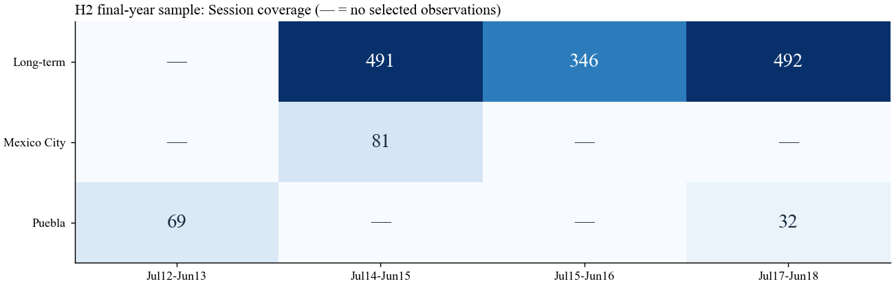

# DID Collinearity Audit

[](https://github.com/Kingland-Kylo/did-collinearity-audit/actions/workflows/reproduce.yml)

对 Motolinia（2021，**American Political Science Review**）公开复现资料的 Python 重建与识别检查。项目先复现 H1/H3，再检查 H2 末年估计样本中的处理项是否具有州和时间固定效应之外的独立变化。

**Main finding.** In the original H2 final-year subsample, the treatment indicator is exactly in the span of state and month–year fixed effects. Its coefficient is not separately identified under that specification. This finding is specific to the audited subsample and specification; it does not establish that all results or the underlying theory are invalid.

## 结果概览

| 检查 | 本地复现结果 | 解释 |
|---|---:|---|
| H1：长期 vs 无连任 | +1.5253 个百分点；N=4,899 | 点估计可复现，处理项有独立变化 |
| H3：长期 vs 短期 | +2.6233 个百分点；N=6,062 | 点估计可复现，处理项有独立变化 |
| H2末年：加入 D 前后的矩阵秩 | 59 → 59；N=1,511 | 完整固定效应规格下，D 不增加独立信息 |
| H2末年：逐行检查 | 全部满足 D=L+E−P | 两个年月窗口指示项减去一个州指示项，精确表示 D |
| 保留 D、额外省略2016年6月 | β≈+4.5992 个百分点 | 额外约束下的参数化；不是完整规格中独立识别的效应 |
| 保留 D、额外省略2014年7月 | β≈+5.5773 个百分点 | 与上一参数化具有相同拟合值 |
| 短期 vs 无连任，补充分析 | −1.9598 个百分点；wild bootstrap p=0.0625 | 少聚类和处理前变化限制因果解释 |

关键问题并非系数是否显著，而是同一批数据是否能把处理项与固定效应分开。这里指定不同 β、相应调整固定效应，可保持相同预测。完整推导及影响评估见 [NOTES.md](NOTES.md)，逐步计算见 [notebooks/audit.ipynb](notebooks/audit.ipynb)。



## 运行

Python 3.13 为已验证环境。无需 Stata 或 R。以下命令在仓库根目录执行；也可使用已经安装依赖的现有虚拟环境。

```bash
python -m venv .venv
```

激活环境：Windows PowerShell 使用 `./.venv/Scripts/Activate.ps1`；macOS/Linux 使用 `source .venv/bin/activate`。随后执行：

```bash
python -m pip install -r requirements.txt
python data/download.py
python -m unittest discover -s tests -v
python code/01_replicate.py
python code/02_diagnose.py
python code/03_robustness.py
```

如需查看 notebook，在支持 Jupyter 的编辑器中打开 `notebooks/audit.ipynb`。公开版本清空保存输出，避免重新分发原始逐行记录；运行后表格和图形会在本机生成。也可以执行：

```bash
python -m ipykernel install --user --name python3
python -m jupyter nbconvert --execute --to notebook --ExecutePreprocessor.timeout=600 --output audit.executed.ipynb --output-dir output notebooks/audit.ipynb
```

## 文件与证据

```text
data/download.py              从 Dataverse 下载并校验来源文件
data/sources.json             文件ID、固定SHA256、来源版本
code/audit_lib.py             共享固定效应估计、bootstrap与识别检查
code/01_replicate.py          H1/H3及其原文安慰剂切点
code/02_diagnose.py           H2筛选、恒等式、秩、参数约束、补充记录
code/03_robustness.py         短期组补充比较与替代规格敏感性
notebooks/audit.ipynb         阅读顺序、方法解释、可执行计算
tests/test_audit.py           识别边界、来源完整性及原文数值核对
output/                      可重新生成的聚合结果与图形
NOTES.md                     技术说明、范围与尚待核实事项
```

源码文件不会读取原先的 Obsidian 分析目录、绝对个人路径或隐藏中间结果。下载文件仅进入被 Git 忽略的 `data/raw/`。GitHub Actions 从官方来源下载后执行同一套检查，不缓存或上传原始数据。

## 证据边界

- **H2：**结论限定于原脚本 `timingc` 末年子样本及所写的完整固定效应规格。H1/H3未发现相同的完全共线性；点估计可复现不等于所有因果假设已经验证。
- **4.60：**保留D并额外省略2016年6月，可以重构这一数值；作者当时实际省略哪一项仍需原生Stata日志核实。本项目没有运行Stata。
- **替代规格：**同一末年样本改用州和年份固定效应，仍然不识别；删除时间固定效应或改用线性趋势后可以估计，但改变了时间混淆的控制和识别假设，不作为原H2已修复的证据。
- **短期比较：**属于补充分析。逐项安慰剂与联合检验分开报告，不由正文未报告该组比较推断作者动机。
- **测量与附录：**沿用作者已估计的CTM份额；没有重新训练CTM，也没有全面复跑原文附录的全部稳健性分析。作者附录代码由获取脚本下载，供继续查阅。

## 来源与许可

Motolinia, Lucia. 2021. “Electoral Accountability and Particularistic Legislation: Evidence from an Electoral Reform in Mexico.” *American Political Science Review* 115(1): 97–113. [论文 DOI](https://doi.org/10.1017/S0003055420000672)；[Harvard Dataverse V1](https://doi.org/10.7910/DVN/NOMC0H)。

Dataverse明确限制在其他位置分发该数据集，要求下载直接来自Dataverse。仓库因此不包含原始数据或原作者代码，见 [数据说明](data/README.md)。本项目新写的代码与说明采用 [MIT License](LICENSE)；原始资料的权利和条款由来源决定。

本项目是非官方的复现与方法审计。提出问题时，请注明数据哈希、命令、输出和具体规格，便于逐项核对。
